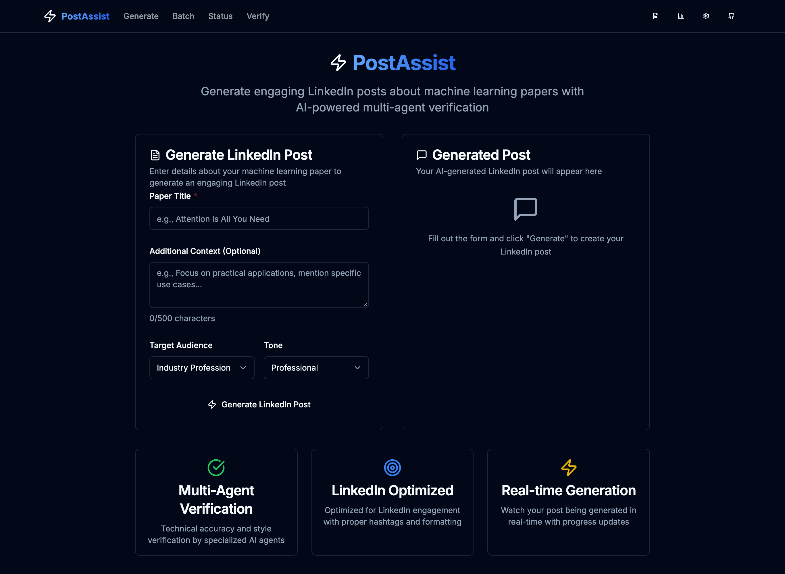
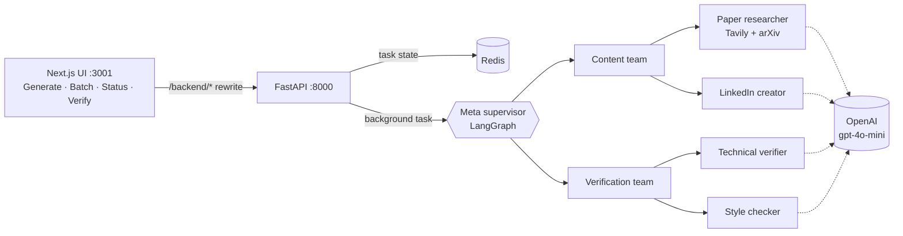
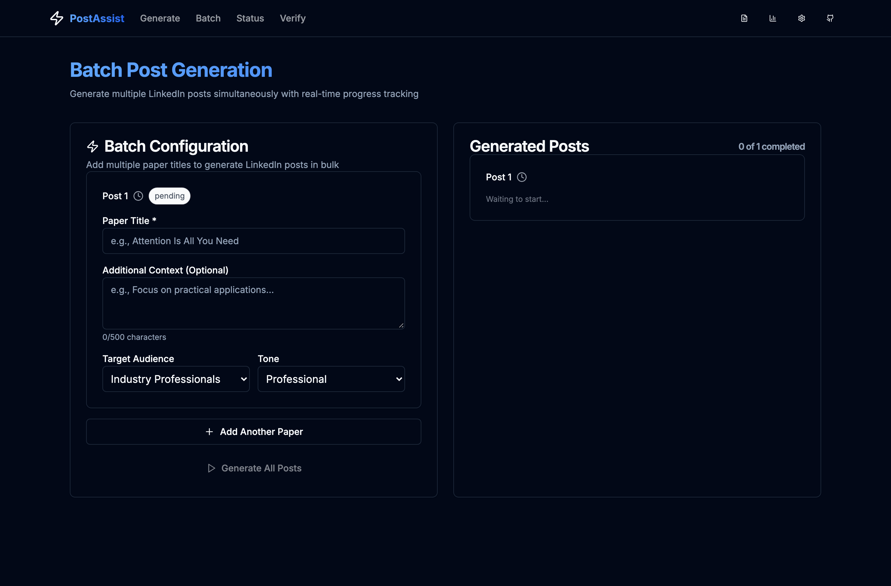
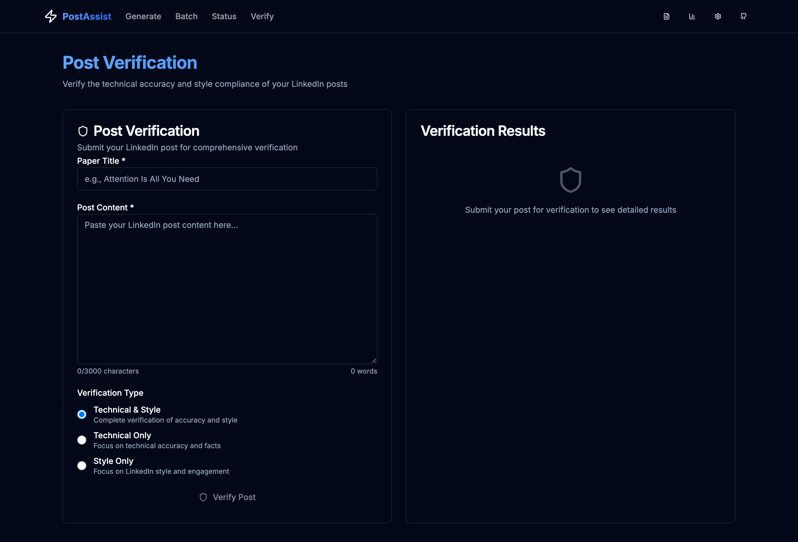
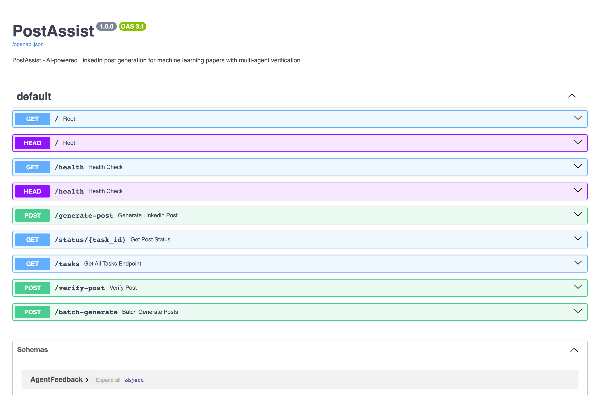
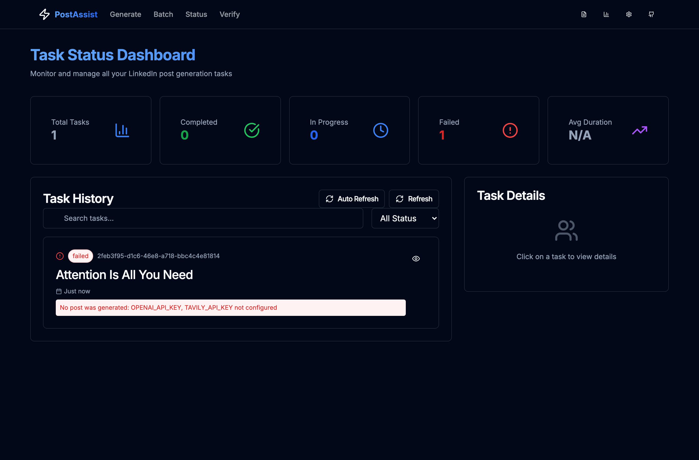

# PostAssist

<p align="center"></p>

> Type the title of a machine-learning paper and get a LinkedIn post about it. Behind the scenes, a LangGraph team of agents researches the paper, writes the post, and checks it for technical accuracy and style.



## Business case

Writing a good post about a research paper takes an expert's time, and unchecked AI drafts can get the facts wrong. PostAssist uses one team of agents to research and write the post and a second team to check its accuracy and style before a person sees it. The savings are modest and the quality still has to be proved on real papers. [docs/BUSINESS_CASE.md](docs/BUSINESS_CASE.md) covers the use cases, an illustrative ROI model and the limits.

## 1. The idea

Writing a good post about a research paper takes two kinds of skill: understanding the paper, and writing for LinkedIn. PostAssist gives each job to its own agent and adds a second team that checks the result before you see it.

## 2. How it works

<p align="center"></p>



1. The UI posts a request to `/generate-post`. The API returns a `task_id` right away and runs the agent graph in the background.
2. The UI polls `/status/{task_id}` and shows each team's and each agent's progress.
3. Tasks live in Redis for 2 hours. If Redis is down, they are kept in memory.

## 3. Run it

```bash
cp .env.example .env     # add OPENAI_API_KEY and TAVILY_API_KEY to generate posts
docker compose up --build
```

| Service | URL |
|---|---|
| Web app | http://localhost:3001 |
| API + Swagger | http://localhost:8000/docs |
| Redis browser (optional) | `docker compose --profile tools up` → http://localhost:8081 |

Without keys the app still starts. `/health` reports `degraded`, and generation tasks fail with a clear message. Set `REQUIRE_API_KEYS=true` to refuse to start without keys instead.

## 4. The pages

> **These screenshots were taken without an OpenAI or Tavily key.** No model was run, so no generated post or verification score appears anywhere below. The pages, the task flow and the failure state are real.

| Generate | Batch |
|---|---|
|  |  |

| Verify (needs a key; not run) | API docs |
|---|---|
|  |  |

**A generation attempt with no key.** It was submitted from the Generate page ([generate-no-key.png](docs/screenshots/generate-no-key.png)). On the Status dashboard it shows up as failed, with the reason:



Raw `/health` and `/tasks` responses from that run are in [api-samples.json](docs/screenshots/api-samples.json).

## 5. API

| Method | Path | Purpose | Needs keys |
|---|---|---|---|
| GET | `/health` | OpenAI, Tavily and Redis status | no |
| POST | `/generate-post` | start a generation task | yes |
| GET | `/status/{task_id}` | progress per team and per agent, plus the result | no |
| GET | `/tasks` | task history | no |
| POST | `/verify-post` | check an existing post | yes |
| POST | `/batch-generate` | several papers at once | yes |

## 6. What changed for local use

| Before | Now |
|---|---|
| `frontend/src/lib/api-client.ts` was missing from git: the root `.gitignore` rule `lib/` (meant for Python) excluded it, so the frontend could not build from a clone | client rebuilt from the call sites and types; `.gitignore` re-includes `frontend/src/lib/` |
| The API crashed on startup without keys (key check plus the Tavily tool built at import time) | starts, warns and reports `not_configured`; strict mode via `REQUIRE_API_KEYS` |
| A run that produced no text was marked **completed** with an empty post | marked **failed** with the reason |
| Compose ran only the API, Redis and Redis Commander | adds the Next.js frontend (standalone build, `/backend` proxy); Redis Commander moved behind a `tools` profile; Redis no longer published on the host |

## 7. Tests and CI

```bash
docker compose run --rm --no-deps -v "$PWD/tests:/app/tests" -v "$PWD/requirements-dev.txt:/app/requirements-dev.txt" \
  api sh -c "pip install -q -r requirements-dev.txt && python -m pytest -q tests"
```

There are 5 offline tests (startup without keys, health, key checks, validation, the task endpoints). `scripts/test_api.py` is the original smoke test, run against a live server. GitHub Actions runs pytest, then the Next.js build, then `docker compose build`.

## 8. More

* [Original README](docs/ORIGINAL_README.md) · [Backend guide](docs/BACKEND_TECHNICAL_GUIDE.md) · [Frontend guide](docs/FRONTEND_TECHNICAL_GUIDE.md) · [Agentic AI guide](docs/AGENTIC_AI_GUIDE.md)
* The research notebook: `Multi_Agent_RAG_LangGraph.ipynb`. Hosted deploys: `deploy/` (Railway) and `frontend/vercel.json`.
